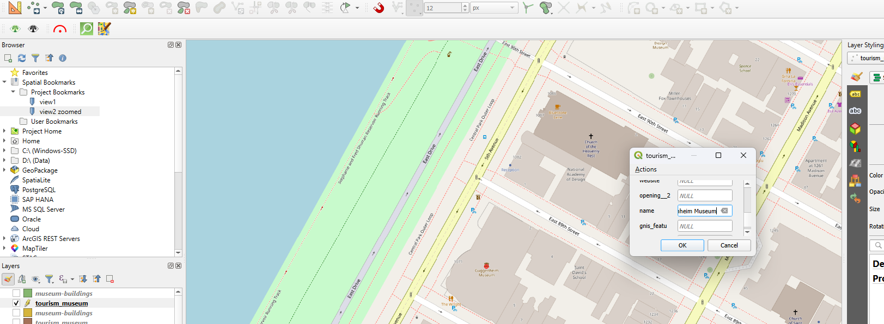
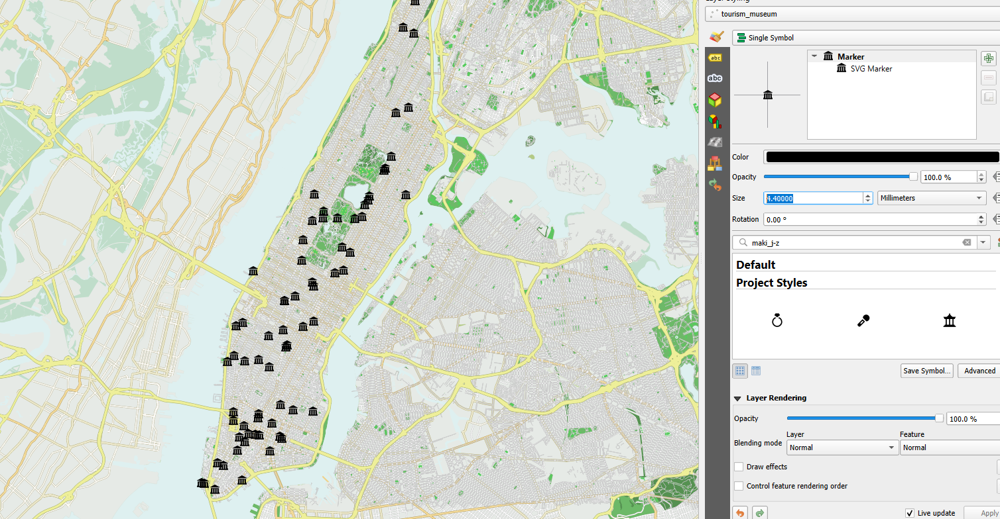

# Museums in Manhattan, New York

**[View the live map](https://geha238.github.io/MAP671-Final-Map-Project/)**

## Why I Made This Map
I made this map because of a recent trip I took to New York to vsee museums. I wanted to see how many museums were actually in New York.

## Data Sources
- Open Street Maps
- Copies of the data are in the `data` folder.

## Projection
- Final map: EPSG: 3857

## How I Made the Map
1. Downloaded the data from Open Street Maps quikc query for a base map.
2. Downloaded parks and museum points data from Open Street Maps quick query.
3. Not all of the museums had points, or some had polygons and no points, so I digitized the remaining museums that did not have a point.

4. Next, I found and downloaded a symbol that represented a museum, and stylized that.

5. Last, I built a layout with a legend, scale bar, and north arrow, then exported two sizes (600 dpi and 1,200 dpi).

## Software
QGIS 3.44.15

## License
MIT